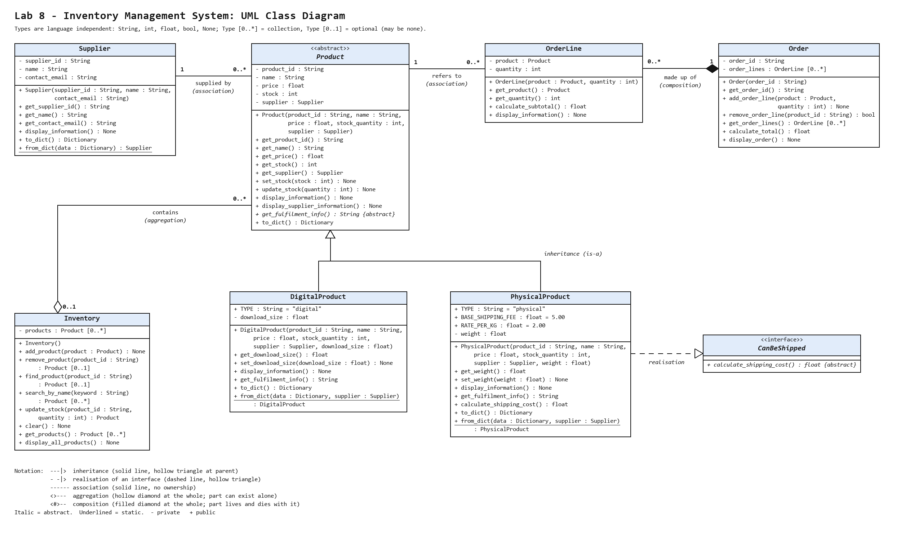
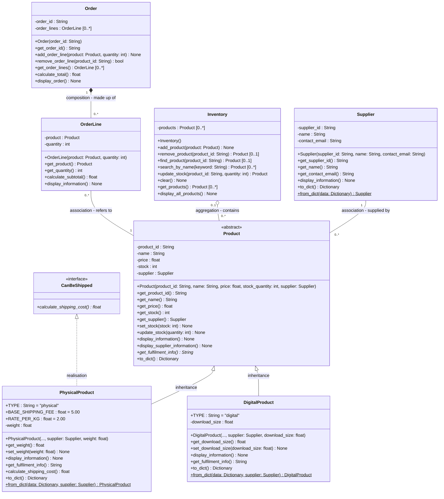

# UML Class Diagram – Lab 8 Inventory System

The PNG above is the submitted diagram. The Mermaid version below renders on GitHub and shows the same design.

## Relationships

| From → To | Relationship | Multiplicity | Why |
|---|---|---|---|
| PhysicalProduct → Product | Inheritance (solid line, hollow triangle) | – | PhysicalProduct *is-a* Product |
| DigitalProduct → Product | Inheritance (solid line, hollow triangle) | – | DigitalProduct *is-a* Product |
| PhysicalProduct → CanBeShipped | Realisation (dashed line, hollow triangle) | – | Only physical products can be shipped |
| Supplier — Product | **Association** (solid line) | Supplier 1 —— 0..* Product | Product keeps a reference to its Supplier, but neither is part of the other. Both can exist on their own. |
| Inventory ◇— Product | **Aggregation** (hollow diamond at Inventory) | Inventory 0..1 ◇—— 0..* Product | Inventory groups Products, but Products are created outside it and can be removed or moved to another Inventory without being destroyed. |
| Order ◆— OrderLine | **Composition** (filled diamond at Order) | Order 1 ◆—— 0..* OrderLine | Order creates its OrderLines in `add_order_line()`. A line belongs to exactly one Order, is never transferred, and goes away with the Order. |
| OrderLine — Product | **Association** (solid line) | OrderLine 0..* —— 1 Product | A line refers to a Product but does not own it. The same Product can be in many lines and orders. |

**Guiding question: what happens to the part when the whole goes away?**
- Delete a Supplier variable → the Products still hold their reference (association: no whole, no part).
- Empty an Inventory → the Products still exist and can go into another Inventory (aggregation).
- Delete an Order → its OrderLines go with it, but the Products they referred to are untouched (composition for the lines, association for the products).

## Types (Python ↔ UML)

| Python type hint | UML type used |
|---|---|
| `str` | String |
| `list[Product]` | Product [0..*] |
| `list[OrderLine]` / `tuple[OrderLine, ...]` | OrderLine [0..*] |
| `Product \| None` | Product [0..1] |
| `supplier: Supplier` | supplier : Supplier |
| `dict` | Dictionary |
| `-> None` | None (no value returned) |

## Mermaid source

